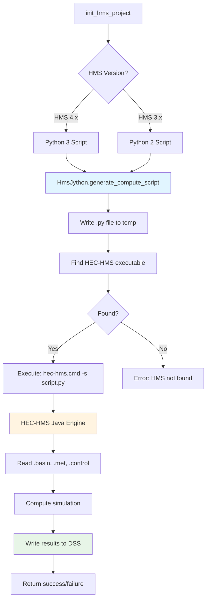

# Execution

Execute HEC-HMS simulations - single runs, parallel execution, and batch processing.

## Overview

The `HmsCmdr` class provides methods for executing HEC-HMS simulations via Jython scripts. Supports single runs, parallel execution, and batch processing.



## Quick Examples

### Single Run

```python
from hms_commander import HmsCmdr

# Execute one simulation
if not HmsCmdr.compute_run("Run 1"):
    raise RuntimeError("Run 1 did not compute; see the log")
```

### How Success Is Decided

`compute_run()` returns `True` only when there is evidence that HEC-HMS computed the run
during the call. Before HEC-HMS starts, HMS Commander reads the run's `Log File:` and
`DSS File:` entries from the project's `.run` files. It locks both files (see
[Concurrent Computes](#concurrent-computes)) and then prepares them:

- An existing run log is moved aside to `<log name>.hms-commander-prev-<32 hex>`, a
  name unique to this call, in the same folder. An existing file is never replaced.
  Any run log present after the run was therefore written while this call held the
  lock, even when its bytes equal the earlier log's. If the run writes a new log, the
  backup is deleted, as HEC-HMS replaces a run's log when it computes the run. If
  the run writes none, the earlier log is moved back.
- The results DSS file's size and modification time are recorded, with a SHA-256
  hash for files up to 512 MB.

After the run, all of these must hold:

- The generated Jython script completed. It did not print `Error opening project:` or
  `Error during computation:`.
- A run log exists, and it has a section for this run. The section starts at
  `NOTE 15301: Began computing simulation run "<run name>"` and ends at the next
  `NOTE 15301` of any run. It has `NOTE 15302` ("Finished computing simulation run")
  for this run, no `ERROR` line and no `WARNING 15303` ("Aborted run").
- The results DSS file is new, or its size, modification time or hash changed.

Nothing is compared with the clock. A file server whose clock differs from the
computer running HMS Commander does not change the result. A results DSS file that
the run did not change fails the check, however recent its time.

The DSS comparison has two limits:

- For a DSS file up to 512 MB, a rewrite with different bytes is detected even when
  a FAT or network file system keeps the same coarse time and the size does not
  change.
- A DSS file over 512 MB is compared by size and modification time only, so a
  same-size rewrite that keeps the time is not detected. A rewrite that leaves every
  byte, the size and the time unchanged is not detected at any size.

In both cases the run is reported as failed rather than wrongly as computed.

The log alone decides which run a result belongs to. A shared results DSS file does
not show which run wrote it. HEC-HMS 4.13 rewrites a run log for every run it
computes, so in one HEC-HMS session a log shared by several runs keeps only the
last run's section. `compute_batch()` therefore computes runs that share a `Log File:`
one HEC-HMS session per run, in the given order, in the same project folder, and
verifies each run before the next starts. Runs with their own logs still share one
session.

If the run is not in a `.run` file, or has no `Log File:` or `DSS File:` entry, the run
cannot be verified and `False` is returned. Every run in the HEC-HMS 4.4.1 to 4.13
sample projects has both entries.

Otherwise the call returns `False` and logs the reason at ERROR level, together with
the run-log lines involved. Warnings in the log, such as `WARNING 40503` (missing
precipitation set to zero), do not make a run fail; check for them when they matter.
`compute_parallel()`, `compute_batch()` and `compute_with_parameters()` apply the same
checks to each run.

A results DSS file alone is not evidence of a computed run. HEC-HMS 4.10 created
the `tenk` sample's results DSS file and then aborted the run (`ERROR 20137`, then
`WARNING 15303`).

### Concurrent Computes

Each compute locks its run's log file and results DSS file from before HEC-HMS starts
until verification is done. The lock holds across threads and processes, so another
compute can't write those files in between and have its result credited to this run.
A copied `dest_folder`, and each `compute_parallel()` worker folder, are locked the
same way while they are filled and computed.

- **Independent runs are not held up.** Runs that write their own log and DSS files
  compute at the same time, even in one project folder. Runs that share a log or DSS
  file take turns.
- **Waiting is bounded.** A compute waits up to its `timeout` for another compute on
  the same files, then raises `TimeoutError` naming the holder (process id, host,
  run). A nested compute on the same files in the same thread raises `RuntimeError`
  at once instead of waiting for itself.
- **Lock files.** A lock is an operating-system lock on a file named
  `<file>.hms-commander-lock` beside the locked file. It is deleted on release. If a
  process dies while holding a lock, the operating system releases it, and the next
  compute logs a warning naming the dead holder and takes the lock over, so a crash
  never leaves the project blocked. On a network share, this relies on the share
  honouring byte-range locks: SMB shares do, NFS may not.
- **`compute_parallel()` worker folders.** Each running task takes a free worker
  folder (`worker_0` to `worker_<max_workers - 1>`) and gives it back when done, so
  two runs never share a worker folder at once.

**Backups left by an interrupted compute** (for example, a killed Python process)
are dealt with by the next compute of that run, while it holds the lock:

- If the run log is missing and there is one backup, that compute wrote no new
  log, so the backup is the earlier log. It is moved back, with a warning.
- Otherwise (a current log exists, or there are several backups), the backups are
  kept and listed in a warning for you to review or delete.

A backup is never read as evidence of a run. Files with other names, such as a
file you named `<log name>.hms-commander-prev`, are never touched.

### HEC-HMS Version Selection

Without `hms_exe_path`, the installation is chosen from the `Version:` line of the
project's `.hms` file:

1. the installation with that exact name, or an equal version (4.4.0 for 4.4);
2. otherwise the newest installation of the same major.minor that is newer than the
   project (4.7.1 for a 4.7 project, 4.13 for a 4.13-beta project), with a warning;
3. otherwise the newest release of the nearest newer major.minor, with a warning.
   HEC-HMS may upgrade the project files when it saves them.

Versions are compared as numbers. Trailing zeros are ignored, and a suffixed
pre-release sorts before its release:

4.4 = 4.4.0 < 4.4.1 < 4.9 < 4.10 < 4.13-alpha < 4.13-beta < 4.13-beta2 < 4.13-beta10 < 4.13-rc2 < 4.13-rc10 < 4.13 < 4.13.1

A pre-release suffix is `alpha` (or `a`), `beta` (or `b`) or `rc`, optionally followed by a number that is compared as a number. Separators and case are ignored, so `4.13 Beta 2` equals `4.13-beta2`. Any other suffix, such as `4.13-rc1-hotfix`, is ambiguous and is not compared.

An older HEC-HMS is never substituted, including an older patch or a pre-release
of the project's version. `compute_run()` raises `RuntimeError` in two cases:

- only older versions are installed;
- the project's `Version:` is not a comparable version, for example an ambiguous
  suffix, and no installation has that exact name.

To use a specific installation, pass it explicitly. A warning is logged if it is
older than the project:

```python
init_hms_project(project_folder, hms_exe_path=r"C:/Program Files/HEC/HEC-HMS/4.13")
```

`HmsJython.find_hms_executable()` without a version returns the newest installation
in this order (4.13 before 4.13-beta, 4.10 and 4.9).

### Parallel Execution

```python
# Run multiple simulations in parallel
runs = ["Run 1", "Run 2", "Run 3", "Run 4"]
HmsCmdr.compute_parallel(runs, max_workers=4)
```

### Batch Processing

```python
# Sequential batch execution
HmsCmdr.compute_batch(["Run 1", "Run 2", "Run 3"])
```

### Execution with Modified Parameters

```python
# Run with temporary parameter modifications
HmsCmdr.compute_with_parameters(
    run_name="Run 1",
    basin_file="model.basin",
    modifications={
        "Subbasin1": {"curve_number": 85},
        "Subbasin2": {"curve_number": 78}
    }
)
```

## HMS Version Support

HMS Commander supports both HMS 3.x (32-bit) and HMS 4.x (64-bit):

### HMS 4.x (Recommended)
```python
# Auto-detected for HMS 4.x
HmsCmdr.compute_run("Run 1")
```

### HMS 3.x (Legacy)
```python
# Requires Python 2 compatible scripts
from hms_commander import HmsJython

script = HmsJython.generate_compute_script(
    project_path="C:/Project",
    run_name="Run 1",
    python2_compatible=True  # Important for HMS 3.x
)

HmsJython.execute_script(script, hms_exe_path="C:/Program Files (x86)/HEC/HEC-HMS/3.5")
```

## Execution Methods

### HmsCmdr (Simplified)
- `compute_run()` - Single simulation
- `compute_parallel()` - Multiple runs in parallel
- `compute_batch()` - Sequential batch processing
- `compute_with_parameters()` - Temporary modifications

### HmsJython (Advanced)
- `generate_compute_script()` - Create Jython script
- `execute_script()` - Run Jython via HEC-HMS
- `find_hms_executable()` - Locate HMS installation
- Version-aware script generation (Python 2 vs 3)

## Parallel Execution Best Practices

```python
import os

# Determine optimal worker count
cpu_count = os.cpu_count()
max_workers = max(2, cpu_count - 2)  # Leave cores for system

# Execute in parallel
HmsCmdr.compute_parallel(
    run_names=["Run_A", "Run_B", "Run_C", "Run_D"],
    max_workers=max_workers
)
```

## Memory Configuration

For large models, configure Java heap memory:

```python
# Custom memory allocation
script = HmsJython.generate_compute_script("project", "Run 1")
HmsJython.execute_script(script, hms_exe_path="path/to/hms", max_memory="8G")
```

## Related Topics

- [API Reference: HmsCmdr](../api/hms_cmdr.md) - Execution methods
- [API Reference: HmsJython](../api/hms_jython.md) - Jython script generation
- [Run Configuration](run_configuration.md) - Setting up runs
- [Results Analysis](results_analysis.md) - Processing results

---

*For complete API documentation, see [HmsCmdr](../api/hms_cmdr.md) and [HmsJython](../api/hms_jython.md) API references*
